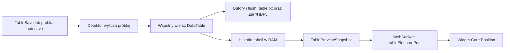

<!-- markdownlint-disable MD033 -->

# mumax³

**GPU-accelerated micromagnetism.**

Paper on the design and verification of MuMax3: <http://scitation.aip.org/content/aip/journal/adva/4/10/10.1063/1.4899186>

<!-- [](https://travis-ci.org/mumax/3) -->

## Downloads and documentation

👉 Pre-compiled binaries, examples, and documentation are available on the [mumax³ homepage](https://mumax.github.io).

Documentation of several tools, like `mumax3-convert`, is available [here](https://godoc.org/github.com/mumax/3/cmd).

### Quick install (Linux x86_64)

The releases of this repository can be installed without a local Go or CUDA toolkit:

```bash
sh -c "$(curl -fsSL https://raw.githubusercontent.com/MateuszZelent/3/master/install.sh)"
```

The default destination is `~/.local/bin`; pass a destination as the first argument to `install.sh` when needed. The target machine still needs a compatible NVIDIA driver.

Maintainers publish a release from a clean, synchronized `master` checkout with:

```bash
just release
```

The recipe derives the next dated tag from `engine.VERSION` (for example `v3.12.0-20260818`), asks for confirmation, and pushes the annotated tag. The tag triggers `.github/workflows/release.yml`, which builds, tests, and uploads the installer assets. Override the inferred tag only when needed with `MUMAX_RELEASE_VERSION=v3.12.1-20260818 just release`. Set `MUMAX_RELEASE_YES=1` only for an intentional non-interactive invocation.

Use `just package-release` to prepare the three release assets locally without publishing a tag.

### Queue web UI: local, LAN, and reverse proxy

Supplying multiple `.mx3` files starts the GPU queue. By default its overview
and worker UIs bind to `127.0.0.1`; open `http://localhost:35367` locally.

To use the queue from another machine on a trusted LAN, bind explicitly to all
interfaces and allow the queue port plus one worker port per GPU through the
firewall:

```bash
mumax3 -http=0.0.0.0:35367 job-a.mx3 job-b.mx3
```

The overview runs on `35367`; workers use `35368`, `35369`, and so on. Links
preserve the hostname or IP address used by the browser, rather than the
machine hostname.

For a reverse proxy with one path per internal port, use a final path component
equal to the queue port. The queue will derive sibling worker paths and retain
the public HTTPS origin from `Forwarded` or `X-Forwarded-*` headers:

```bash
mumax3 -http=127.0.0.1:35367/proxy/35367 job-a.mx3 job-b.mx3
```

Map `/proxy/35367` to the queue and `/proxy/35368`, `/proxy/35369`, etc. to
the worker ports. Do not expose the UI to untrusted networks: it has no
authentication; put it behind an authenticated proxy or a VPN.

## Śledzenie rdzenia w tabeli i WebUI: vortex / skyrmion

Widget **Plots → Core Position** pokazuje próbki z tabeli bieżącej symulacji.
Typ detektora wybiera skrypt MX3. W UI wyświetlany jest tryb `Vortex` albo
`Skyrmion` i status lokalizacji; obecnie nie ma przełącznika zmieniającego detektor.
Instrukcja dotyczy implementacji opisanej w [raporcie naprawy](doc/audits/output-coreposition-2026-10-21/IMPLEMENTATION.md).
Używaj binarium z tą implementacją; starsze wydania mogą nie udostępniać nowych funkcji.

### Wielkość MX3 a nazwy kolumn

`ext_corepos` jest zarejestrowaną **wielkością wektorową** MX3. Wywołanie
`TableAdd(ext_corepos)` rozbija ją na trzy kolumny: `ext_coreposx`,
`ext_coreposy`, `ext_coreposz`. Te nazwy kolumn nie rejestrują samodzielnych
wielkości w interpreterze.

```go
// Poprawnie: dodanie całej wielkości do tabeli.
TableAdd(ext_corepos)

// Niepoprawnie jako odwołanie do wbudowanej wielkości MX3:
// TableAdd(ext_coreposx)
// TableAdd(ext_coreposy)
```

Zalecane `CoreTrack()` dodaje `ext_corepos` i `ext_corevalid` oraz ustawia tryb
widgetu na vortex. `SkyrmionTrack(p)` dodaje osobne wielkości skyrmionu,
validity i polaryzację oraz ustawia tryb skyrmionu.
Sam `TableAdd(ext_corepos)` też uruchamia tryb vortex, ale nie dodaje kolumny
`ext_corevalid`; widget odrzuca wówczas nieważne pozycje na podstawie NaN/Inf.

| Wywołanie | Powstające kolumny | Znaczenie |
| --- | --- | --- |
| `CoreTrack()` | `ext_coreposx`, `ext_coreposy`, `ext_coreposz`, `ext_corevalid` | X/Y w metrach; legacy Z to bezwymiarowa polaryzacja rdzenia, a nie położenie Z; validity 1 albo 0 |
| `SkyrmionTrack(1)` lub `SkyrmionTrack(-1)` | `ext_skyrmionposx`, `ext_skyrmionposy`, `ext_skyrmionposz`, `ext_skyrmionvalid`, `ext_skyrmionpol` | X/Y/Z w metrach, ważność oraz osobna bezwymiarowa polaryzacja |

Tabela ma ponadto czas `t` i domyślne kolumny średniej magnetyzacji `mx`, `my`, `mz`.
`TableAdd`, `CoreTrack` i `SkyrmionTrack` definiują kolumny — próbkowanie włącza
osobne `TableAutoSave(period)` albo jawne `TableSave()`.

### Przykład vortex: plik vortex-demo.mx3

```go
SetGridSize(128, 128, 1)
SetCellSize(2e-9, 2e-9, 2e-9)
Msat = 800e3
Aex = 13e-12
alpha = 0.1
m = Vortex(1, 1)

CoreTrack()
CoreLayer = -1           // najsilniejszy rdzeń spośród warstw
TableAutoSave(1e-12)     // okres próbkowania: 1 ps czasu symulacji
TableSave()             // pierwsza próbka także bez uruchamiania solvera
Flush()
```

Uruchom w trybie interaktywnym, aby po wykonaniu skryptu otworzyć widget:

```sh
mumax3 -i -http=127.0.0.1:35367 -o vortex-demo.zarr vortex-demo.mx3
```

Otwórz adres wypisany przez program i wybierz **Plots → Core Position**.
Jedna próbka pokazuje pozycję, a kolejne próbki powstaną podczas `Run(...)`
lub `Steps(...)`. W pliku można dopisać np. `Run(100e-12)` przed końcowym
`Flush()`, aby obserwować 100 ps dynamiki.

Flaga CLI `-core` włącza to samo śledzenie vortex co `CoreTrack()`.
Nadal wymaga próbkowania tabeli; nie wybiera automatycznie detektora skyrmionu.

### Przykład skyrmionu: plik skyrmion-demo.mx3

```go
SetGridSize(192, 160, 1)
SetCellSize(1e-9, 1e-9, 1e-9)
Msat = 800e3
Aex = 13e-12
alpha = 0.1
m = NeelSkyrmion(1, 1).Transl(11.25e-9, -7.75e-9, 0)

SkyrmionTrack(1)         // oczekiwany znak mz rdzenia; nie chiralność
SkyrmionSeedX = 11.25e-9
SkyrmionSeedY = -7.75e-9
SkyrmionLayer = -1
TableAutoSave(1e-12)
TableSave()
Flush()
```

```sh
mumax3 -i -http=127.0.0.1:35367 -o skyrmion-demo.zarr skyrmion-demo.mx3
```

Ten przykład tworzy i lokalizuje konfigurację statyczną. Stabilny skyrmion
podczas dynamiki wymaga właściwego modelu fizycznego i parametrów materiału,
np. odpowiednich oddziaływań, anizotropii i pola. Funkcja śledzenia nie stabilizuje
tekstury. Dla rdzenia skierowanego w −Z użyj `SkyrmionTrack(-1)` i konfiguracji
magnetyzacji z taką polaryzacją.

### Wybór konkretnego obiektu i parametrów

**Vortex:** detektor wybiera najsilniejszy zlokalizowany pik `|mz|` w geometrii.
`CoreLayer = -1` przeszukuje wszystkie warstwy, a indeks `0, 1, ...` wybiera
jedną warstwę. Przy kilku wirach nie ma identyfikatora obiektu ani kojarzenia
z poprzednią pozycją; zmiana najsilniejszego piku może zmienić śledzony wir.

**Skyrmion:** rozdzielane są spójne rdzenie o oczekiwanym znaku `mz`. Pierwszy
wybierany jest najbliżej `(SkyrmionSeedX, SkyrmionSeedY)`, domyślnie `(0, 0)`.
Następne próbki odnoszą się do poprzedniej poprawnej pozycji.

| Parametr | Domyślnie | Jak używać |
| --- | --- | --- |
| `SkyrmionPolarity` | argument `SkyrmionTrack(p)` | `+1` lub `-1`: znak magnetyzacji rdzenia |
| `SkyrmionBackground` | `-p` | Tło `mz` o znaku przeciwnym do rdzenia; własną wartość ustaw po `SkyrmionTrack(p)` |
| `SkyrmionThreshold` | `0.1` | Odcinany kontrast tła, bezwymiarowy; wymagane `0 <= threshold < 1` |
| `SkyrmionSeedX`, `SkyrmionSeedY` | `0`, `0` m | Początkowy punkt wyboru w układzie laboratoryjnym |
| `SkyrmionSearchRadius` | `0` m | Zero: cała domena; dodatni promień: obszar wokół bieżącego punktu odniesienia |
| `SkyrmionMaxDisplacement` | `0` m | Zero: automatyczny limit na podstawie rozmiaru poprzedniego rdzenia i komórki; dodatnia wartość: jawny limit ruchu między próbkami, także odległości pierwszego rdzenia od ziarna |
| `SkyrmionLayer` | `-1` | Agregacja połączonych warstw; indeks `0, 1, ...` wybiera jedną warstwę |

Po utracie lokalizacji poprzednia poprawna pozycja pozostaje odniesieniem.
`SkyrmionReset()` usuwa to skojarzenie: kolejna próbka ponownie wybiera obiekt
względem ziarna. Nie usuwa dotychczasowej historii tabeli.
To skojarzenie przestrzenne, bez trwałych identyfikatorów cząstek; dobierz okres
próbkowania i limit ruchu tak, aby sąsiednie obiekty nie mogły być mylone.
Obszar poszukiwania musi obejmować cały rdzeń i otaczające tło.

### Skąd widget dostaje dane



`TablePlotState.GetCorePosData()` pobiera `t`, kolumny X/Y wybranego detektora
i jego validity. WebSocket przesyła wiersze `[t, x, y, valid]`, tryb i status.
Frontend przelicza współrzędne na nm i liczy metryki trajektorii.
`tablePlot.corePos` jest polem komunikatu UI, a nie funkcją MX3 ani osobnym
plikiem. Widget nie odczytuje `table.txt`/Zarr i nie uruchamia własnego detektora
na GPU. Otwieranie widgetu nie tworzy nowych próbek.

W zwykłym **Table Plot** można wybrać np. `t` i `ext_coreposx` do wykresu X(t).
Zakładka **Core Position** niezależnie pobiera X i Y po ich standardowych nazwach;
zmiana osi zwykłego wykresu nie zmienia rodzaju detektora. `TableAddAs(...)`
z innymi nazwami może zapisać poprawne dane, których widget nie rozpozna.
Samo `TableAdd(ext_bubblepos)` także nie włącza tego widgetu jako detektora skyrmionu.

`Max points` i `Step` ograniczają/przerzedzają podgląd obu wykresów. Nie zmieniają
próbek zapisanych na dysku. `Orbit window` ogranicza odcinek używany do metryk.
Zbyt rzadki podgląd może uniemożliwić wiarygodne wyznaczenie częstotliwości.
`Orbit radius` jest promieniem ruchu środka, **nie promieniem rdzenia**.
Przy pojedynczym punkcie, nieruchomym rdzeniu lub niewystarczającej orbicie
częstotliwość `—` jest prawidłowym wynikiem.

### Kolejność operacji i rozwiązywanie problemów

1. Zdefiniuj geometrię, materiał i magnetyzację.
2. Wybierz jeden detektor przez `CoreTrack()` albo `SkyrmionTrack(p)` i ustaw parametry.
3. Zrób to przed pierwszym `TableSave()`, pierwszą automatyczną próbką lub `TablePrint()` inicjalizującym tabelę. Schemat otwartej tabeli jest stały.
4. Włącz `TableAutoSave(period)` lub wykonuj `TableSave()`. Okres jest w sekundach czasu symulacji; pauza nie generuje automatycznie nowych próbek.
5. Użyj `Flush()`, gdy potrzebujesz utrwalenia istniejących próbek. Flush nie dopisuje próbki. Bufory są też opróżniane okresowo według czasu rzeczywistego.
6. Otwórz **Plots → Core Position** i sprawdź tryb oraz status.

| Objaw | Co sprawdzić |
| --- | --- |
| `undefined: ext_coreposx` | W MX3 użyj `CoreTrack()` lub `TableAdd(ext_corepos)`. Sufiks X jest nazwą wynikowej kolumny |
| Brak zakładki lub danych | Czy wybrano detektor, powstała pierwsza próbka i są standardowe nazwy kolumn? Samo `Save(m)` / `AutoSave(m, ...)` zapisuje pola, nie tabelę |
| Błąd dodawania kolumn po uruchomieniu | Przenieś wybór detektora przed inicjalizację tabeli i uruchom nowy przebieg |
| Widać niewłaściwy tryb | `-core` oznacza vortex. Używaj jednego helpera; jeśli oba zostaną włączone przed pierwszą próbką, ostatnie wywołanie helpera wybiera tryb widgetu |
| `valid=0`, brak metryk | Sprawdź polaryzację, tło, rozdzielczość, warstwę, geometrię, brzeg/ROI i limit ruchu. Nieważna pozycja ma NaN w tabeli; UI oznacza przerwę i nie łączy jej w trajektorię |
| Wykres jest nowszy niż plik | UI korzysta z historii w RAM. `Flush()` utrwala już zapisane próbki; nie zmienia ich liczby |

Pełny zapis jest w `table.txt` i — dla odpowiedniego formatu — w `table/`.
Podgląd UI jest ograniczony do końcowego okna historii. Zatwierdzoną tabelę
strukturalną można wyeksportować bezpośrednio:

```sh
mumax3 table skyrmion-demo.zarr/table > skyrmion-table.txt
```

Test vortex na GPU obejmuje translację, obie polaryzacje i 100 kroków dynamiki;
testy skyrmionu obejmują 64 konfiguracje rozmiaru/polaryzacji/profilu. Testy
przeglądarkowe sprawdziły skyrmion, utratę/odzyskanie, reconnect i Break.
Zakres testów, logi i ograniczenia są w [raporcie naprawy](doc/audits/output-coreposition-2026-10-21/IMPLEMENTATION.md).
Przykłady z tego README uruchomiono również bezpośrednio na GPU: vortex,
skyrmion i wariant `TableAdd(ext_corepos)` przeszły; `TableAdd(ext_coreposx)`
zakończył się oczekiwanym błędem kompilacji. [Wyniki i nazwy uzyskanych kolumn](doc/audits/output-coreposition-2026-10-21/proof/readme-usage-proof.json).

## Contributing

Contributions are gratefully accepted. To contribute code, fork our GitHub repo and send a pull request.

## Building from source

Consider downloading a [pre-compiled mumax³ binary](https://mumax.github.io/download.html).

If you want to compile nevertheless, 4 essential components will be required to build mumax³: an ***NVIDIA driver***, ***Go***, ***CUDA*** (&leq;12.9) and ***C***.

* *If they are not yet present on your system*: install them as detailed below.
* *If they are already installed*: check if they work correctly by running the *check* for each component written below.

Click on the arrows below to expand the installation instructions:<br><sub><sup>These instructions were made for Windows 10 and Ubuntu 22.04 (but should be applicable to all Debian systems). Your mileage may vary.</sup></sub>

<details><summary><b><i>Install an NVIDIA driver</i></b></summary>

* **Windows**: Find a suitable driver [here](https://www.nvidia.com/en-us/drivers/).
* **Linux**: [Install the NVIDIA proprietary driver](https://www.nvidia.com/en-us/drivers/unix/). <!-- version 440.44 recommended --><details><summary>Troubleshooting Linux &rarr;click here&larr;</summary>
  If the following error occurs, proceed as follows:

  ```batch
  nvidia-smi has failed because it couldn't communicate with the NVIDIA driver. Make sure that the latest NVIDIA driver is installed and running
  ```

  1) Check for existing NVIDIA drivers.
      * Run `dpkg -l | grep nvidia` to see if any NVIDIA drivers are installed.
      * If it shows some drivers, you might want to uninstall them before proceeding with the clean installation: `sudo apt-get --purge remove '*nvidia*'`
  2) Update system packages. Make sure your system is up to date with `sudo apt update` and `sudo apt upgrade`.
  3) (Optional but recommended:) Add the official NVIDIA PPA to ensure you have access to the latest NVIDIA drivers with `sudo add-apt-repository ppa:graphics-drivers/ppa` and `sudo apt update`.
  4) Install the recommended driver. Ubuntu can automatically detect and recommend the right NVIDIA driver for your system with the command `ubuntu-drivers devices`. This will list the available drivers for your GPU and mark the recommended one. <br> To install the recommended NVIDIA driver, use `sudo apt install nvidia-driver-<version>` (replace `<version>` with the number of the recommended driver e.g., nvidia-driver-535)
  5) Reboot your system with `sudo reboot` to apply the changes.

  6) Verify the installation with `nvidia-smi`. This returns something like this, which shows you the driver version in the top center:

  ```bash
      +-----------------------------------------------------------------------------------------+
      | NVIDIA-SMI 552.22                 Driver Version: 552.22         CUDA Version: 12.4     |
      |-----------------------------------------+------------------------+----------------------+
      | GPU  Name                     TCC/WDDM  | Bus-Id          Disp.A | Volatile Uncorr. ECC |
      | Fan  Temp   Perf          Pwr:Usage/Cap |           Memory-Usage | GPU-Util  Compute M. |
      |                                         |                        |               MIG M. |
      |=========================================+========================+======================|
      |   0  NVIDIA GeForce RTX 3080 ...  WDDM  |   00000000:01:00.0 Off |                  N/A |
      | N/A   53C    P8              9W /  115W |     257MiB /   8192MiB |      0%      Default |
      |                                         |                        |                  N/A |
      +-----------------------------------------+------------------------+----------------------+

      +-----------------------------------------------------------------------------------------+
      | Processes:                                                                              |
      |  GPU   GI   CI        PID   Type   Process name                              GPU Memory |
      |        ID   ID                                                               Usage      |
      |=========================================================================================|
      |    0   N/A  N/A     28420    C+G   ...Programs\Microsoft VS Code\Code.exe      N/A      |
      |    0   N/A  N/A     31888    C+G   ...les\Microsoft OneDrive\OneDrive.exe      N/A      |
      +-----------------------------------------------------------------------------------------+
  ```

  </details>
* **WSL**: Follow the instructions and troubleshooting for Linux above. If you encounter issues/errors during that process, see the troubleshooting section below: <details><summary>Troubleshooting WSL &rarr;click here&larr;</summary>
    When using Windows Subsystem for Linux, your graphics card might not be recognized. If an error occurs after running the command:

    1) If `ubuntu-drivers devices` throws the error
        * `Command 'ubuntu-drivers' not found`: run the command `sudo apt install ubuntu-drivers-common`.
        * `ERROR:root:aplay command not found`: run the command `sudo apt install alsa-utils`.
    2) If `sudo apt install nvidia-driver-<version>` throws the error `E: Unable to locate package nvidia-driver-<version>`: run the commands

        ```bash
        sudo apt install software-properties-gtk
        sudo add-apt-repository universe
        sudo add-apt-repository multiverse
        sudo apt update
        sudo apt install nvidia-driver-<version> 
        ```

    3) If `nvidia-smi` throws the error `nvidia: command not found`: the controller is probably not using the correct interface (`sudo lshw -c display` should show NVIDIA). To solve this, follow [these steps](https://learn.microsoft.com/en-us/windows/wsl/tutorials/gpu-compute). If a `docker: permission denied` error occurs: close and re-open WSL.

  </details>

👉 *Check NVIDIA driver installation with: `nvidia-smi`*

</details>

<details><summary><b><i>Install CUDA</i></b> &leq;12.9</summary>

* **Windows**: Download an installer from [the CUDA website](https://developer.nvidia.com/cuda-downloads).
  * ⚠️ **To be on the safe side, it is recommended to install CUDA in a directory without spaces, like `C:\cuda`.** Spaces should not cause issues when running `deploy_windows.ps1`, but this is not guaranteed.
* **Linux**: Use `sudo apt-get install nvidia-cuda-toolkit`, or [download an installer](https://developer.nvidia.com/cuda-downloads).
  * Pick the default installation path. **If this is not `usr/local/cuda/`, create a symlink to that path.**
  * Match the version shown in your driver (see top right in `nvidia-smi` output).
  * When prompted what to install: do not install the driver again, only the CUDA toolkit.
  * Add the CUDA `bin` and `lib64` paths to your `PATH` and `LD_LIBRARY_PATH` by adding the following lines at the end of your shell profile file (usually `.bashrc` for Bash):

    ```bash
    export PATH=/usr/local/cuda/bin:$PATH
    export LD_LIBRARY_PATH=/usr/local/cuda/lib64:$LD_LIBRARY_PATH
    ```

    Apply the changes with `source ~/.bashrc`.

👉 *Check CUDA installation with: `nvcc --version`*

</details>

<details><summary><b><i>Install Go</i></b></summary>

* Download and install from [the Go website](https://go.dev/doc/install).
* The `GOPATH` environment variable should have been set automatically (note: the folder it points to probably doesn't exist yet).<br>*Check with `go env GOPATH`.* <details><summary><i>Click here to set `GOPATH` manually if it does not exist.</i></summary>
  * On **Windows:** `%USERPROFILE%/go` is often used, e.g. `C:/Users/<name>/go`. See [this guide](https://www.wikihow.com/Change-the-PATH-Environment-Variable-on-Windows) if you are unfamiliar with environment variables.
  * On **Linux:** `~/go` is often used. Open or create the `~/.bashrc` file and add the following lines.

    ```bash
    export GOPATH=$HOME/go
    export PATH=$GOPATH/bin:$PATH
    ```

    After editing the file, apply the changes by running `source ~/.bashrc`.
    </details>

👉 *Check Go installation with: `go version`*

</details>

<details><summary><b><i>Install a C compiler</i></b></summary>

* **Linux:** `sudo apt-get install gcc`
  * ⚠️ each CUDA version has a maximum supported `gcc` version. [This StackOverflow answer](https://stackoverflow.com/a/46380601) lists the maximum supported `gcc` version for each CUDA version. If necessary, use `sudo apt-get install gcc-<min_version>` instead, with the appropriate `<min_version>`.
* **Windows:**
  * CUDA does not support the `gcc` compiler on Windows, so download and install [Visual Studio](https://visualstudio.microsoft.com/downloads/) with the "Desktop development with C++" workload.  After installing, check if the path to `cl.exe` was added to your `PATH` environment variable (i.e., check whether `where cl.exe` returns an appropriate path like `C:\Program Files\Microsoft Visual Studio\2022\Community\VC\Tools\MSVC\14.29.30133\bin\HostX64\x64`). If not, add it manually.
  * To compile Go, on the other hand, `gcc` is needed. Usually this is included in the Go installation, but if not it can be downloaded and installed from [w64devkit](https://github.com/skeeto/w64devkit/releases).

👉 *Check C installation with: `gcc --version` on Linux and `where.exe cl.exe` on Windows.*

</details>

<details><summary>(Optional: <b><i>install git</i></b> to contribute to mumax³)</summary>

<sub><sup>If you don't have a GitHub profile yet, make one [here](https://github.com/join).</sup></sub>

* **Windows:** [Download](https://git-scm.com/downloads) and install.
  <!-- If Git shows many changed .go files, but the files do not have any visible changes, this is likely due to a different line ending being used. Run `git config core.autocrlf input` in the `mumax/3` directory to avoid changing the line ending. -->
* **Linux:** `sudo apt install git`
* [Set up your username in Git](https://docs.github.com/en/get-started/getting-started-with-git/setting-your-username-in-git) and [setup an SSH key for your GitHub account](https://docs.github.com/en/authentication/connecting-to-github-with-ssh/adding-a-new-ssh-key-to-your-github-account).

👉 *Check Git installation with: `git –-version`*

</details>

<details><summary>(Optional: <b><i>install gnuplot</i></b> for pretty graphs)</summary>

* **Windows:** [Download]((http://www.gnuplot.info/download.html)) and install.
* **Linux:** `sudo apt-get install gnuplot`

👉 *Check gnuplot installation with: `gnuplot -V`*

</details>

With these tools installed, you can build mumax³ yourself.

* Within your `GOPATH` folder, create the subfolders `src/github.com/mumax`.
* Clone the GitHub repository by running `git clone https://github.com/mumax/3.git` in that newly created `mumax` folder.
  * If you don't have git, you can manually fetch the source [here](https://github.com/mumax/3/releases) and unzip it into `$GOPATH/src/github.com/mumax/3`.
* Query the compute capability of your GPU using the command `nvidia-smi --query-gpu=compute_cap --format=csv`. Based on this, set the environment variable `CUDA_CC`: if your compute capability is e.g., 8.9, then set the value `CUDA_CC=89`.
* By moving into the newly created folder with `cd 3/`, you can now compile mumax³ ...
  * ... **on Linux:**

    ```bash
    make realclean
    make
    ```

    Your binary is now at `$GOPATH/bin/mumax3`.

    Note: each CUDA version has a maximum supported GCC version. If your default GCC compiler is too recent, you can use a different GCC compiler by instead running `make NVCC_CCBIN=<path_to_gcc>` where `<path_to_gcc>` is a less recent GCC. [Check the version compatibility here](https://stackoverflow.com/a/46380601). Alternatively, setting the `NVCC_CCBIN` environment variable achieves the same thing, allowing you to run `make` as usual.

  * ... **on Windows:**
    The `Makefile`s may experience issues with whitespaces. Instead, we recommend to use the `deploy/deploy_windows.ps1` script: this generates the Windows executables for the [mumax³ download page](https://mumax.github.io/download.html), but can also be used to build a single mumax³ executable for yourself by making the following adjustments:
    1) Change the `$VS2022` variable to point to your Visual Studio executable. If you wish to compile for CUDA versions below v11.6, also set `$VS2017`. Example: if `where.exe cl.exe` returns `foo\bar\cl.exe`, then set `$VS2022 = "foo\bar"`.
    2) (Not strictly necessary, but check this anyway) Throughout the file there are several `switch ( $CUDA_VERSION )` blocks. If these do not address your installed CUDA version, add your version. Consult nearby comments when in doubt.

    Now you can compile mumax³ by opening Powershell in the `/deploy` directory and running

    ```bat
    ./deploy_windows.ps1 -CUDA_VERSIONS <your_cuda_version> -CUDA_CC <your_compute_capability>
    ```

    where e.g. `<your_cuda_version>` is `12.6` and `<your_compute_capability>` is `86`, if you have installed CUDA v12.6 and your GPU's compute capability is 8.6.

    Your executable will be created in the `deploy/build` directory.

* *Check installation with: `which mumax3` on **Linux** or `where.exe mumax3.exe` on **Windows**, followed by `mumax3 -test`.* <details><summary>Troubleshooting: `cuda.h` or `curand.h` not found: &rarr;click here&larr;</summary>
  This usually means that the `CGO_CFLAGS` and `CGO_LDFLAGS` environment variables are not found or point to the wrong path. To fix this, either define them in the script you are using to build mumax³, or define them in the terminal before running the script.
  * On **Windows:** set the environment variable `CUDA_PATH` to point to your CUDA folder (e.g. `C:\Program Files\NVIDIA GPU Computing Toolkit\CUDA\v12.9`), then run these two lines in Powershell before running `deploy_windows.ps1`:

    ```powershell
    $env:CGO_CFLAGS = "-I `"$($env:CUDA_PATH)\include`""
    $env:CGO_LDFLAGS = "-L `"$($env:CUDA_PATH)\lib\x64`""
    ```

  </details>
  <details><summary>Troubleshooting: `mumax3.exe` is not generated: &rarr;click here&larr;</summary>

  If, during the build process of mumax³, everything runs smoothly until you get the error that the `mumax3.exe` executable can not be found, try setting the `CGO_ENABLED` environment variable to `1` in your build script.

  </details>
  <details><summary>Troubleshooting: `vcvars64.bat` not found or could not initialise VC environment: &rarr;click here&larr;</summary>

  CUDA requires Visual Studio to compile, which tries to set various environment variables.
  If Visual Studio fails to do so automatically, you can open a new shell, manually run the `vcvars64.bat` file there (the error message should contain the path to this Batch file), and then compile mumax using that shell.

  </details>
  <details><summary>Troubleshooting: Windows errors not mentioned above: &rarr;click here&larr;</summary>

  If you encounter an error during compilation on Windows, other than those mentioned above, you may try to run the compilation commands in the "Developer Powershell for VS 20XX" that should have been automatically installed alongside MSVC. Sometimes this special shell solves conflicts between MSVC and CUDA, sometimes not.

  </details>
